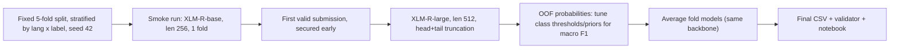

# RMIT Hackathon 2026 C1: what the dataset shows and the plan

> Scripts: [inspect1.py](../scripts/eda/inspect1.py), [inspect2.py](../scripts/eda/inspect2.py). I ran them in a temporary `uv` environment, so nothing was installed into the workspace or the global Python.

> [!WARNING]
> The Kaggle deadline is **today, 22 Oct, at 18:00 (UTC+7)**. That is about 17.5 hours from now, and the event itself only opens at 08:00. Plan around a first valid submission by midday. It is still unconfirmed whether training before the official start is allowed (agent.md §23).

## 1. What I verified in the data

| # | Finding | Evidence | Implication |
|---|---|---|---|
| 1 | The files are **clean UTF‑8**. PowerShell shows garbled accents (`Ac`, `A�`) only because of its console encoding. | Raw bytes show `\xc3\xa9` = `é`; there are 0 `U+FFFD` replacement characters | Always read with `encoding="utf-8"`. Do not try to "fix" the text. |
| 2 | **Test looks like train.** The language mix is identical (45/25/20/10), and the length distributions match (median 283 vs 294 chars, p95 1519 vs 1543). | `inspect1` | Train and test come from one shuffled pool. A stratified CV on train should predict the leaderboard well. |
| 3 | **The IDs are interleaved.** Train and test both draw IDs from t000000–t019999, and the class mix is flat across ID bins. | `inspect1` | The ID carries no signal and there is no time drift. `sample_submission` is in the same order as `test.csv`. |
| 4 | **Leakage is low.** No test text appears in train exactly. Only 88 test rows have a train neighbour with char‑TF‑IDF cosine > 0.9 (182 rows > 0.8). The 211 near-duplicate pairs inside train have **0 label conflicts**. | `inspect2`, nearest neighbours | A plain random stratified K‑fold is fine. Grouped splits are not needed. |
| 5 | **Newlines are stripped** from every text. | 0% contain `\n` | Long structured prompts are flattened into one line. |
| 6 | **The `language` tag is the translation target, not the actual content.** Some rows are code-mixed or untranslated (Vietnamese, Indonesian, German, English fragments). | Examples like `"Hãy đặt tiêu đề…"` tagged `pt`, and Indonesian/French mixes in test | A multilingual tokenizer is essential. Do not filter on language. |
| 7 | **Text lengths:** median about 290 chars, p95 about 1.5k chars, max 18.5k. | `inspect1` | Roughly 400 tokens at p95. With `max_len=256`, about 10–15% of rows get truncated; `512` covers about 97%. |

### Where the data probably comes from (my inference from style)

- **JAILBREAK**: looks like WildJailbreak *adversarial‑harmful* prompts. They are long role-play framings ("Imagine a world where…", "As a researcher…") wrapped around a harmful request. 37% contain quotes.
- **BENIGN** is a mix of three kinds:
  - WildJailbreak *adversarial‑benign* prompts. They use **the same role-play style as the jailbreaks** but ask for something harmless. These are the hard negatives.
  - Short chat turns ("raconte-moi une blague nulle").
  - Prompt-marketplace templates. 13% of benign rows contain `[TARGETLANGUAGE]`/`[PROMPT]`-style placeholders, versus 0.1% in the attack classes.
- **PROMPT_INJECTION**: looks like deepset/prompt‑injections plus Gandalf/TensorTrust-style prompts. These are short commands such as "Ignore previous instructions…", "Reveal your system prompt", or "I want you to act as…". 8.5% end with a colon, versus 0.3% elsewhere. Some labels look **noisy** (e.g. "Narrate a scenario where AI is used in judicial decisions" is labelled INJECTION). That is a known quirk of deepset.

## 2. Baseline result (signal floor, not a submission)

This is a char(2–5) + word(1–2) TF‑IDF with logistic regression, scored by 5‑fold CV stratified on language × label:

| Setup | Macro F1 | BENIGN F1 | JAILBREAK F1 | INJECTION F1 |
|---|---:|---:|---:|---:|
| Unweighted | 0.915 | 0.950 | 0.920 | 0.873 (recall 0.78) |
| `class_weight=balanced` | **0.928** | 0.951 | 0.919 | 0.914 (recall 0.87) |

Confusion matrix for the balanced model (rows are the true labels):

```
             BEN   JB   INJ
BENIGN      8219  429   32
JAILBREAK    270 4067    3
INJECTION    111   15  854
```

Per language: fr 0.952, it 0.941, en 0.922, pt 0.910.

**Where the errors come from:**

1. **BENIGN ↔ JAILBREAK** causes about 700 errors, the largest bucket. The two classes share the same adversarial style; what separates them is whether the request is actually harmful. Telling them apart needs semantic understanding, which is what a fine-tuned transformer should add over n-grams.
2. **INJECTION → BENIGN** causes about 110–200 errors. Short or odd injections ("Sfidare le linee guida etiche…") and "act as" templates get missed. INJECTION is only 7% of the data but counts for 1/3 of macro F1, so it needs imbalance handling plus decision-threshold tuning.

> [!NOTE]
> A transformer has to beat **about 0.93 CV** to justify itself. A well-tuned large multilingual encoder should realistically land around 0.95–0.97. That is my estimate; nothing has been measured yet.

## 3. Choosing the backbone (the rules allow only one)

| Model | Fit for this data | Verdict |
|---|---|---|
| `xlm-roberta-large` (560M) | Strongest proven multilingual encoder for classification. Handles code-mixed text. Fits a Kaggle T4/P100 (16 GB) at len 512 with fp16 and gradient checkpointing. | **Primary pick** |
| `mmBERT-base` | Newer ModernBERT-style multilingual model. Fast, with long context (up to 8k), so less truncation. | **Fast path and backup.** Worth a head-to-head comparison if time allows. |
| `xlm-roberta-base` / `mmBERT-small` | Quick to train; the organizer starter uses XLM‑R‑base. | Smoke test / first safe submission |
| `deberta-v3-base-prompt-injection-v2` | Safety-tuned, but the DeBERTa‑v3 tokenizer is **English-centric**, and 90% of the data is pt/fr/it. | Avoid |
| `wolf-defender-prompt-injection` | Base architecture and tokenizer not verified | Check only if time is spare |
| Mistral‑7B / Granite‑2B (LoRA) | LLM safety knowledge could help with BENIGN vs JAILBREAK, but QLoRA on 14k × 512 tokens takes hours per epoch on a T4. | Too risky for a deadline that is about 17 hours away |
| `rembert`, `distilbert-mling` | Weaker or heavier than the options above | Skip |

## 4. Recommended pipeline



**Training recipe (starting point):**

- Learning rate 1e‑5 for large (2e‑5 for base), 10% linear warmup, 2–3 epochs.
- fp16, effective batch about 32 via gradient accumulation; gradient checkpointing for large.
- Pick checkpoints by macro F1.
- `max_len 512`. For the roughly 3% of longer texts, keep the first ~384 and last ~128 tokens. The attack payload is often at the end ("…Now ignore the above and…").
- Loss: mild class weights, such as the square root of inverse frequency. Compare against plain cross-entropy.
- **Tune decision thresholds on out-of-fold predictions after training.** Scaling the per-class logit biases to maximise OOF macro F1 costs almost nothing and usually adds +0.5–1.5 points when one class is rare.
- **Keep the text exactly as it is.** Do not lowercase or strip punctuation: quotes, colons, `[PLACEHOLDER]` tokens and casing all carry signal.
- **Ensemble the 5 fold models** of the *same* backbone, or refit on the full data at the end. Whether a TF‑IDF component in the ensemble counts as "another model" is unclear, so ask the organizers before doing it.

**Compute plan:**

- **Kaggle GPU** (T4×2 or P100) is the main venue for XLM‑R‑large.
- **Local RTX 5060 (8 GB)** works for base-size iteration. It is a Blackwell GPU (sm_120), so it needs a **PyTorch build with CUDA 12.8 or newer**; older wheels will not work. XLM‑R‑large at len 512 will be tight locally, so only use local compute if organizers allow external compute.

**Rough time budget on a T4 (estimates):**

| Model | Time per fold per epoch | 5 folds × 3 epochs |
|---|---|---|
| XLM‑R‑base, len 256 | ~4 min | — |
| XLM‑R‑large, len 512 | ~20–25 min | ~5–6 h |

That 5–6 h does not fit comfortably, so:

- Use **3 folds**, or 1 fold plus a full-data refit.
- Or train the large model on both T4s in parallel across two team accounts. Each person has their own GPU quota; this has to stay within the rules.

## 5. Decisions I need from you or the organizers

1. **Backbone**: XLM‑R‑large (best accuracy, slower) or mmBERT‑base (faster, less truncation)? I recommend XLM‑R‑large, with an XLM‑R‑base/mmBERT‑small run first as the safety submission.
2. **Where to run**: Kaggle-only, or local GPU allowed too? Local needs a `.venv` with CUDA 12.8+ PyTorch, which I have not created.
3. **Rule clarifications**: Are same-backbone fold ensembles allowed? Is TF‑IDF blending allowed? Can work start before 08:00? Are the 6 submissions total or per day?
